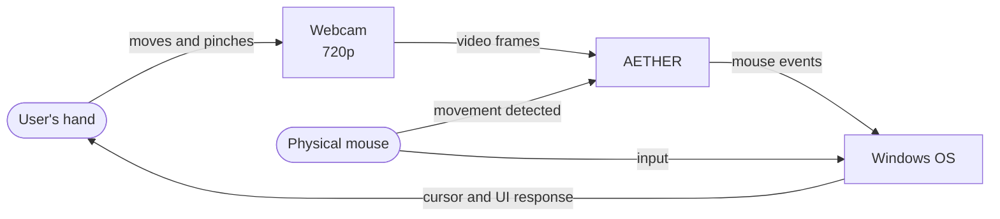
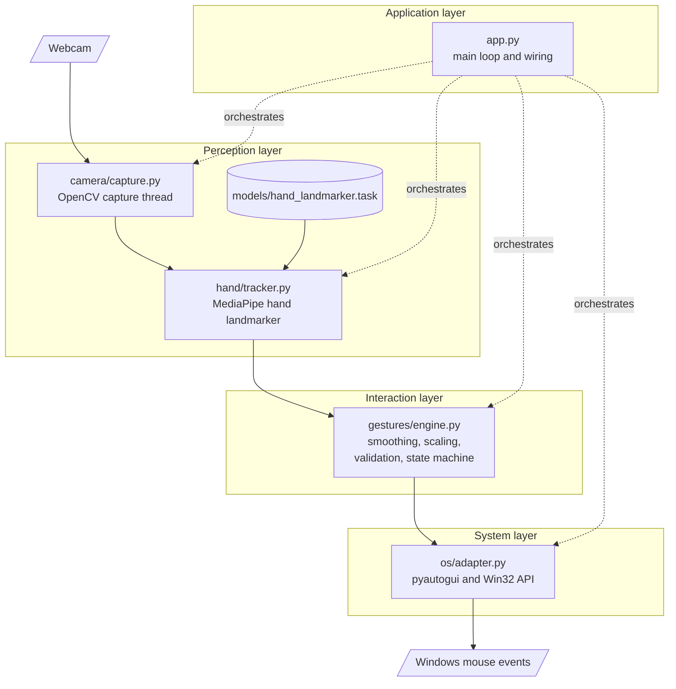
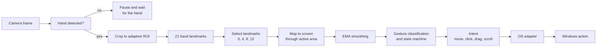
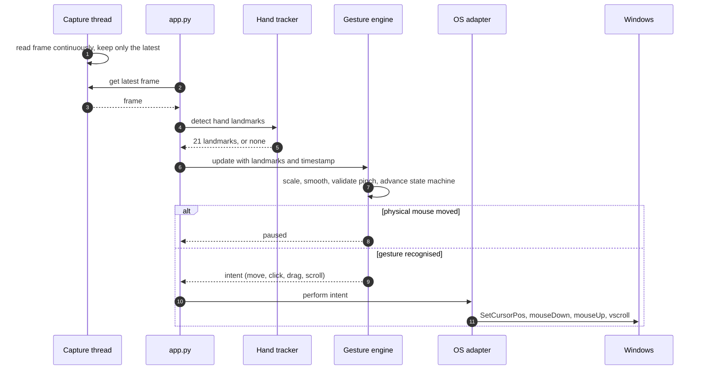
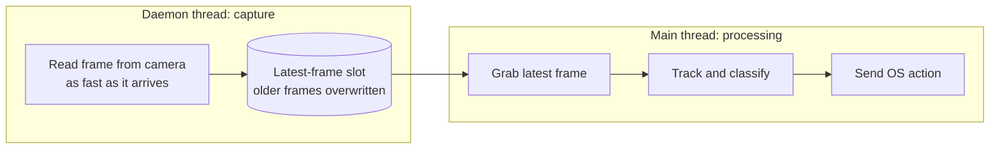
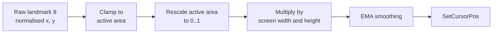
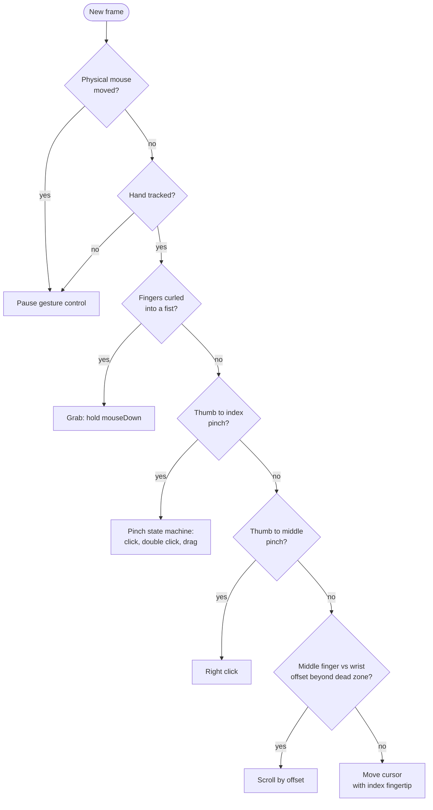
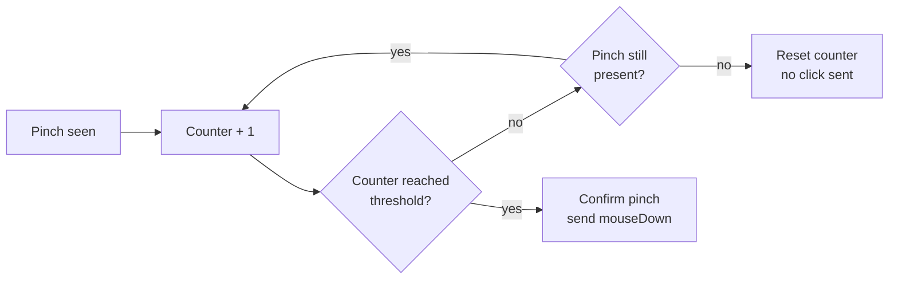
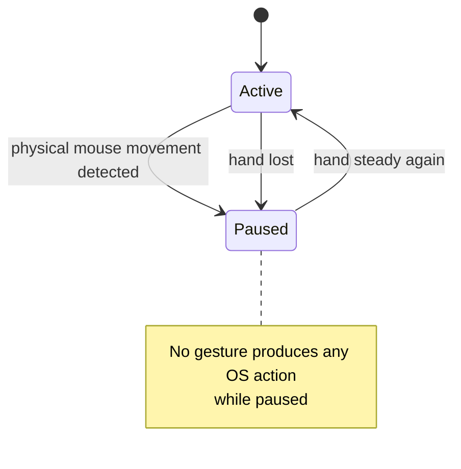
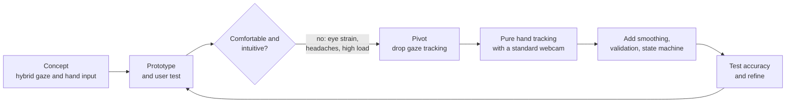

<div align="center">

# AETHER

### Touchless desktop control with nothing but your hand and a webcam


<!-- Replace with a demo GIF:  -->

</div>

AETHER is a lightweight, low-latency computer vision system that lets you operate a Windows desktop through hand gestures alone. It needs a standard webcam and nothing else: no depth sensor, no gloves, no headset, no gaze tracker.

> **Design goal:** make touchless input feel as dependable as a physical mouse, while keeping the hand relaxed and the arm low.

---

## Table of contents

1. [Why AETHER](#why-aether)
2. [Features](#features)
3. [Demo and screenshots](#demo-and-screenshots)
4. [Gesture dictionary](#gesture-dictionary)
5. [Architecture](#architecture)
6. [Interaction engineering](#interaction-engineering)
7. [Design process and the pivot away from eye gaze](#design-process-and-the-pivot-away-from-eye-gaze)
8. [Performance](#performance)
9. [Repository structure](#repository-structure)
10. [Getting started](#getting-started)
11. [Usage](#usage)
12. [Troubleshooting](#troubleshooting)
13. [Limitations](#limitations)
14. [Roadmap](#roadmap)
15. [Tech stack](#tech-stack)
16. [Acknowledgements](#acknowledgements)
17. [Author](#author)

---

## Why AETHER

Mouse and keyboard assume clean, free hands and a desk. That assumption breaks in sterile environments, at public kiosks, and in ergonomically constrained workspaces. Touchless input is the obvious answer, but most "air mouse" attempts fail in practice for three reasons:

| Problem | What users experience |
| --- | --- |
| **Gorilla arm** | Holding the arm aloft tires the shoulder within minutes. |
| **Cursor jitter** | Raw camera tracking is noisy, so the pointer vibrates and precise targets are unreachable. |
| **Unreliable clicking** | A single misread frame fires an accidental click, and a quick click cannot be told from a drag. |

AETHER is built around three requirements that answer these directly:

- **Ergonomic comfort.** Relaxed, desk-level hand positions. The user never has to reach.
- **High precision.** Stable cursor with low jitter, still responsive.
- **Zero install hardware.** Works with an ordinary consumer webcam (designed around 720p).

### How AETHER compares with other approaches

| Approach | What it offers | What it costs |
| --- | --- | --- |
| Depth sensors | Accurate 3D hand pose | Extra hardware to buy and carry |
| Gloves and wearables | Precise finger sensing | Must be worn, set up and charged |
| Gaze tracking | Hands-free pointing | Specialised hardware, calibration, eye fatigue |
| **Webcam and landmark model (AETHER)** | No new hardware | Noise, lighting and occlusion must be handled in software |

---

## Features

- **Sub-pixel cursor tracking.** The index-fingertip landmark is mapped to full-screen coordinates, smoothed with an exponential moving average (EMA), and applied through direct Win32 calls for fluid movement.
- **Precise gesture state machine.** Single click, double click, drag and drop, and right click, each with explicit timing rules.
- **Scroll control.** Driven by the vertical offset between the middle finger and the wrist.
- **Temporal click validation.** A pinch must persist for several consecutive frames before it counts, which removes tracking-glitch clicks.
- **Reduced active area.** A relaxed zone in the camera view maps onto the whole screen, so corners are reachable without large arm movements.
- **Hardware override protection.** Physical mouse movement instantly pauses gesture control, so the two input sources never fight.
- **Threaded, low-latency pipeline.** A dedicated capture thread always serves the freshest frame.
- **Adaptive region of interest.** After detection, tracking concentrates on the hand area instead of the whole frame.

---

## Demo and screenshots

Add your media here. Suggested files:

| Media | Suggested path | What to show |
| --- | --- | --- |
| Demo GIF | `docs/demo.gif` | Move, click, drag and scroll in one short clip |
| Architecture board | `docs/architecture.png` | Your Figma system diagram |
| Gesture map | `docs/gestures.png` | Each gesture with its hand shape |
| Accuracy heat map | `docs/accuracy-heatmap.png` | Cursor error across the screen |

```markdown


```

---

## Gesture dictionary

| Gesture | Hand configuration | Landmark logic (MediaPipe ID) | OS action |
| --- | --- | --- | --- |
| **Move cursor** | Point with the index finger | Index fingertip (8) | `SetCursorPos(scaled_x, scaled_y)` |
| **Single click** | Quick, brief pinch of thumb and index | Thumb tip (4) to index tip (8) distance below threshold | `mouseDown()` / `mouseUp()` |
| **Double click** | Two quick pinches inside a short time window | Same pinch, repeated within the window | Double click |
| **Drag and drop** | Hold the pinch, or close the hand into a fist (grab), then move | Sustained pinch, or curled-finger configuration | Persistent `mouseDown()` until release |
| **Right click** | Pinch thumb and middle finger | Thumb tip (4) to middle tip (12) | Right click |
| **Scroll** | Raise or lower the middle finger relative to the wrist | Vertical difference of middle (12) and wrist (0) | `vscroll(delta)` |
| **Pause control** | Move the physical mouse | Hardware movement detected | Gesture input suspended |

### Landmarks used

MediaPipe returns 21 landmarks per hand. AETHER reads only a handful of them:

```
                 12  (middle tip: right-click pinch, scroll)
            8    |
  (index tip:    |
   cursor,       |
   click) |      |
          |      |
   4      |      |
 (thumb   |      |
  tip)    |      |
     \    |      |
      \   |      |
       \__|______|
          |
          0  (wrist: scroll reference)
```

| ID | Landmark | Used for |
| --- | --- | --- |
| `0` | Wrist | Scroll reference point |
| `4` | Thumb tip | Pinch partner for click and right click |
| `8` | Index fingertip | Cursor position, click pinch |
| `12` | Middle fingertip | Right-click pinch, scroll signal |

---

## Architecture

### 1. System context

Who and what AETHER talks to.



The loop is closed through the user's eyes: the screen shows what the system understood, and the user adjusts. The physical mouse stays a first-class input, and AETHER steps aside whenever it is used.

### 2. Layered component architecture

Each layer maps to one module in the repository and only talks to its neighbours.



### 3. End-to-end data flow

What happens to a single frame, from light on the sensor to a cursor move.



### 4. Per-frame sequence

The order of calls in one pass of the main loop.



### 5. Threading model

Capture and processing run independently, so a slow processing step never makes the system read old frames.



Without this split, OpenCV's internal buffer queues frames while the app is busy, and the cursor ends up following where the hand was a moment ago. Reading continuously and keeping only the newest frame removes that lag.

### 6. Coordinate mapping and the dead zone

Only a central rectangle of the camera view drives the cursor. That rectangle is stretched to the whole screen.

```
 Camera frame                                   Screen
 +----------------------------------+           +----------------------------------+
 |  dead zone (ignored)             |           |                                  |
 |   +--------------------------+   |           |                                  |
 |   |                          |   |  scale    |                                  |
 |   |      active area         |   | ------->  |           full screen            |
 |   |   (hand moves here)      |   |           |                                  |
 |   |                          |   |           |                                  |
 |   +--------------------------+   |           |                                  |
 |                                  |           +----------------------------------+
 +----------------------------------+
```



Two benefits follow. Small, comfortable hand movements reach every screen corner, and jitter or drift near the frame edge is cut off instead of reaching the cursor.

### 7. Gesture classification

How the engine decides what the hand is doing.



---

## Interaction engineering

Three failures kept camera-based input from feeling reliable. Each has a specific fix.

### 1. Cursor jitter: exponential moving average

Raw MediaPipe coordinates are noisy frame to frame. AETHER smooths the incoming X and Y values with an EMA:

```
S_t = α · Y_t + (1 − α) · S_(t−1)
```

`Y_t` is the new raw reading, `S_(t−1)` the previous smoothed value, and `α` the smoothing factor.

| `α` | Behaviour |
| --- | --- |
| Close to 1 | Follows the hand quickly, passes more noise |
| Close to 0 | Very steady, but the cursor lags behind the hand |

The value is tuned to balance responsiveness against stability.

### 2. False-positive clicks: temporal validation

A pinch seen in one frame may just be a tracking error. A pinch must stay active for a minimum number of consecutive frames (for example, 5) before a click is sent to the operating system. Accidental clicks and unintended double clicks drop sharply.



### 3. Click versus drag: a state machine

Distinguishing a quick click from a sustained drag needs memory of what the hand was doing. AETHER tracks the pinch through explicit states:

```mermaid
stateDiagram-v2
    [*] --> Idle
    Idle --> Pending: pinch detected
    Pending --> Idle: lost before validation
    Pending --> Pressed: held for N frames, mouseDown
    Pressed --> Click: quick release, mouseUp
    Pressed --> Dragging: sustained hold with movement
    Dragging --> Idle: release, mouseUp
    Click --> Idle
```

- **Pinch start** triggers `mouseDown`.
- **Hold** keeps `mouseDown` active for as long as the pinch lasts.
- **Release** triggers `mouseUp`.

Because the button state persists, native drag and drop works: files, windows, sliders and selections behave exactly as with a real mouse.

### 4. Input arbitration: hand versus real mouse

Gesture control and the physical mouse must never fight over the cursor.



### 5. Tracking states and recovery

Hands are imprecise and tracking sometimes fails. The system treats that as a design problem and makes its state clear.

| State | Meaning | System behaviour |
| --- | --- | --- |
| **Tracking** | Hand found and steady | Gestures are live |
| **Unsteady** | Hand found but noisy | Smoothing and validation hold actions back |
| **Lost** | Hand not visible | All actions pause at once, then resume after the hand returns and holds steady |

A resting hand inside the dead zone never fires an action.

---

## Design process and the pivot away from eye gaze

AETHER was developed through rapid prototyping and repeated user testing, with the perception pipeline and accuracy refined between rounds.



**Initial exploration: a hybrid model.** The first concept combined eye-gaze tracking (to point) with hand gestures (to act). In testing it failed:

- **Visual fatigue.** Holding the eyes on specific targets caused quick eye strain and headaches.
- **Cognitive load.** Coordinating gaze with hand actions felt unnatural and added mental friction.

**The pivot: pure hand tracking.** Gaze tracking was dropped entirely. Using hand gestures alone simplified the input model, reduced computational overhead, and let people work with relaxed, natural hand movements tracked by an ordinary 720p webcam.

---

## Performance

| Metric | Result |
| --- | --- |
| Frame rate | 30+ FPS (enabled by threaded capture) |
| End-to-end latency | Under 45 ms |
| Tracking | 21 hand landmarks in 3D space |
| Input hardware | Standard 720p webcam |

> Figures come from the project's own technical evaluation on standard consumer hardware. Results will vary with camera, lighting and machine.

### What keeps latency low

| Technique | Effect |
| --- | --- |
| Dedicated capture thread | Always processes the newest frame, never a queued one |
| Adaptive region of interest | Less pixel data per frame to process |
| Direct Win32 calls | Cursor moves without an emulation layer in between |
| One landmark for the cursor | Minimal work in the hot path |

---

## Repository structure

```
aether/
├── aether/
│   ├── camera/
│   │   └── capture.py         # OpenCV camera capture thread
│   ├── hand/
│   │   └── tracker.py         # MediaPipe hand landmarker wrapper
│   ├── gestures/
│   │   └── engine.py          # Landmark processing and gesture classification
│   └── os/
│       └── adapter.py         # Low-level Windows mouse injection (pyautogui / Win32)
├── models/
│   └── hand_landmarker.task   # MediaPipe task asset model
└── app.py                     # Main application entry point
```

| Module | Responsibility |
| --- | --- |
| `camera/capture.py` | Reads frames on a dedicated daemon thread and always exposes the latest one. |
| `hand/tracker.py` | Wraps the MediaPipe hand landmarker and returns the 21 landmarks per hand. |
| `gestures/engine.py` | Smooths coordinates, scales them to the screen, validates pinches over time, and classifies gestures. |
| `os/adapter.py` | Turns recognised gestures into Windows mouse events through `pyautogui` and the Win32 API. |
| `app.py` | Wires the stages together and runs the main loop. |

### Why this structure

- **Each stage is testable alone.** You can feed recorded landmarks into the engine without a camera, or call the adapter without a hand.
- **Swappable parts.** A different tracker or a different OS adapter can replace one module without touching the rest.
- **Clear ownership.** Perception, interaction logic and OS integration never mix.

---

## Getting started

### Requirements

- Windows 10 or 11
- Python 3.x
- A webcam (720p or better recommended)

### Install

```bash
git clone https://github.com/<your-username>/aether.git
cd aether

python -m venv .venv
.venv\Scripts\activate

pip install opencv-python mediapipe pyautogui pywin32
```

The MediaPipe model file is expected at `models/hand_landmarker.task`.

---

## Usage

```bash
python app.py
```

1. Sit with your hand in the camera view, forearm resting comfortably.
2. Point with your index finger to move the cursor.
3. Pinch thumb and index to click, hold to drag, and pinch thumb and middle finger for right click.
4. Raise or lower the middle finger against the wrist to scroll.
5. Touch the physical mouse at any time to pause gesture control.

**Tips for best results:** use even front lighting, avoid strong backlight, keep the hand inside the frame, and keep the background free of other hands.

---

## Troubleshooting

| Symptom | Likely cause | Try this |
| --- | --- | --- |
| Cursor shakes | Smoothing too weak, or poor light | Lower `α`, improve lighting |
| Cursor feels sluggish | Smoothing too strong | Raise `α` |
| Clicks never fire | Pinch not held long enough, or threshold too strict | Hold the pinch a little longer, loosen the pinch threshold |
| Accidental clicks | Validation window too short | Increase the consecutive-frame requirement |
| Cannot reach screen corners | Active area too large | Shrink the active area |
| Hand keeps getting lost | Backlight, motion blur, hand near the frame edge | Light the hand from the front, stay inside the frame |
| Gestures stop suddenly | Physical mouse was moved | Keep your hand off the mouse, then hold your hand steady |
| No video | Wrong camera index or camera in use | Close other apps using the camera, check the device index |

---

## Limitations

- **Windows only.** The OS adapter uses Win32 calls.
- **One camera, no depth sensor.** Depth is inferred by the landmark model, so very fast motion, motion blur and heavy occlusion can reduce accuracy.
- **Lighting sensitive.** Low light and strong backlight degrade tracking.
- **Single-hand control.** The gesture vocabulary is designed for one hand.
- **Research prototype.** It has not been validated with a formal study across users or assistive-technology contexts.

---

## Roadmap

- [ ] Cross-platform OS adapter (macOS, Linux)
- [ ] User-adjustable sensitivity, smoothing and dead-zone settings
- [ ] Optional calibration step per user and camera
- [ ] Adaptive smoothing that tightens when the hand is still and loosens when it moves fast
- [ ] Formal usability study with accuracy and fatigue measures
- [ ] Wearable camera exploration, such as smart glasses

---

## Tech stack

| Area | Tools |
| --- | --- |
| Language | Python |
| Vision | OpenCV, MediaPipe Hand Landmarker |
| OS integration | PyAutoGUI, Win32 API |
| Interaction design | Figma |

---

## Acknowledgements

- [MediaPipe](https://developers.google.com/mediapipe) for the hand landmarker model and tooling
- [OpenCV](https://opencv.org) for camera capture
- [PyAutoGUI](https://pyautogui.readthedocs.io) for cross-library mouse control

---

## Author

**Gayathri A Menon**: lead interaction designer and developer.

---

## License

Add a license of your choice (for example MIT) and link it here.
